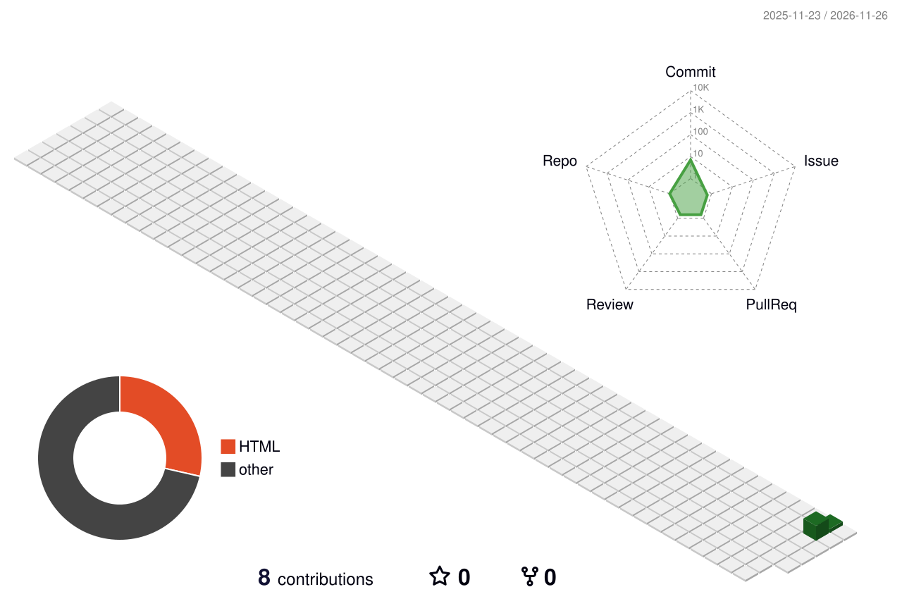

  

 

<!-- About Section -->
<table width="100%">
  <tr>
    <td width="58%" valign="middle">
      <h3>🌱 About Me</h3>
      

        17 y/o student building browser extensions, vision scripts, and web tools.
      

      <ul>
        <li>🔨 working on <b><a href="https://github.com/Swastik-bin/page-arbiter">PageArbiter</a></b></li>
        <li>⚡ python automation, opencv, ocr & chrome extensions</li>
        <li>🎨 three.js, webgl shaders & frontend ui</li>
        <li>💻 macOS • zsh • vs code</li>
      </ul>
    </td>
    <td width="42%" valign="middle" align="center">
      
    </td>
  </tr>
</table>

 

<!-- Tech Stack -->

  <h3>🌲 Tools</h3>
   

  

    
    
    
    
    
  

  

    
    
    
    
    
  

   

  

 

 

<!-- Featured Project: ONLY PageArbiter -->

  <h3>🍃 Featured Project</h3>

<table width="100%">
  <tr>
    <td width="100%" valign="top">
      <h2 align="center">
        <a href="https://github.com/Swastik-bin/page-arbiter">PageArbiter</a>
      </h2>
      

        Real-time webpage fact-checking, credibility scoring, and bias auditing Chrome Extension powered by Gemini Flash and Google Search Grounding.
      

      

        
        
      

      <ul>
        <li><b>Live Claim Verification:</b> Parses active DOM content and cross-checks claims against live web sources.</li>
        <li><b>Credibility & Bias Breakdown:</b> Scores articles on factual backing, framing bias, and source reliability inside a clean extension UI.</li>
        <li><b>Manifest V3 Architecture:</b> Fast client-side scraping and direct API streaming with zero backend bloat.</li>
      </ul>
      

        <a href="https://github.com/Swastik-bin/page-arbiter"><b>→ view repository</b></a>
      

    </td>
  </tr>
</table>

 

 

<!-- GitHub Stats & 3D Contribution City (Forest Theme) -->

  <h3>🌿 Stats</h3>
   

  <!-- Animated 3D Isometric Contribution City + Radar + Language Donut -->
  

    

  <!-- Working Forest Stats & Top Languages Cards -->
  
  

    

  <!-- Working Activity Graph -->
  

 

<!-- Animated Footer Wave -->

  

